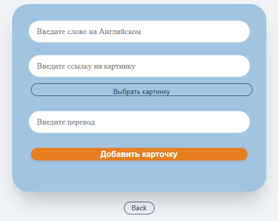
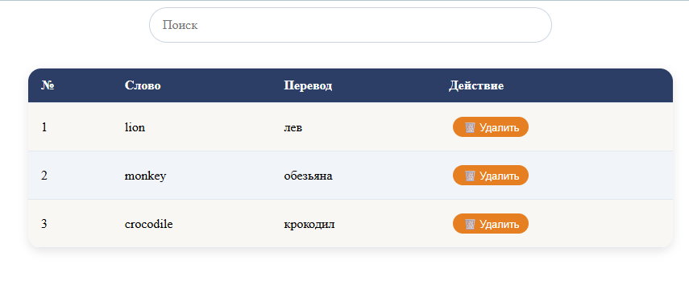

# 📘 Learn English Words – Interactive Flashcard App

A web application to help you learn and memorize English vocabulary using flashcards. You can create your own word sets, practice them, track your progress, and manage your personal dictionary.

🌐 **Live Demo:** [http://gramilya.xyz/english/](http://gramilya.xyz/english/)

---

## 📸 Screenshots

| Add Words | Learning Mode | Word Storage |
|-----------|---------------|---------------|
|  |  |  |

---

## ✨ Features

- **➕ Add new words**
  Enter an English word, its translation, and optionally an image URL or upload an image from your computer. The card is saved to your library.

- **🎤 Голосовой ввод**
  Микрофон рядом с полями: продиктуйте английское слово или перевод — текст подставится сам.
  Работает в Chrome/Edge на `localhost` и по HTTPS (голос распознаёт Google).

- **🗂️ Готовые наборы слов**
  «Топ 250 / 500 / 1000 / 2000» самых частотых слов и уровни Oxford 3000 (A1–B2) с переводами — одной кнопкой в словарь.
  Списки собираются скриптом `npm run build:wordlists` (источники: Oxford 3000 public domain, CEFR-J Vocabulary Profile, FrequencyWords MIT).

- **🖼️ Картинки в наборах**
  Скрипт сборки заранее забирает картинки статей Википедии (батчи по 50 слов, кэш в `scripts/.cache`): **925 картинок для 3063 слов**, у предметных слов покрытие до 80%.
  Картинки произведений (песни, альбомы, фильмы) отсеиваются по описанию статьи.
  В рантайме приложение не ходит в API — просто показывает готовую ссылку.

- **🗒️ Свои списки слов**
  Соберите тематические наборы вручную: «Еда», «Путешествия», «Работа». Слова добавляются из «Хранилища» (кнопка «в список») или со страницы «Добавить», затем заливаются в словарь одной кнопкой.

- **🎯 Что учим — экран выбора**
  Перед тренировкой выбираете: источник слов (все / к повторению / только ошибки / новые / свои списки / готовый набор), направление перевода, формат ответа и размер сессии.

- **📖 Три формата ответа**
  Ввод текста, выбор правильного перевода из четырёх или аудио-режим: слово звучит, вы его пишете.

- **⏱ Интервальное повторение**
  Слово после верного ответа «отдыхает» 1 → 3 → 7 → 21 → 60 дней. Выученные слова возвращаются в тренировку по расписанию, а не исчезают навсегда.

- **📖 Learning mode**
  The app randomly shows either the English word or its Russian translation (50/50 chance). Type your answer – the system checks it and gives instant feedback. After 5 correct answers, the card leaves the active learning set until its next review date.

- **🗄️ Word storage**
  Browse all your cards in a table. Search by English or Russian word. Delete unwanted cards with one click.

- **🧭 Routing**
  Real pages and URLs: `/`, `/learn`, `/add`, `/storage`, `/wordlists`. Browser back/forward works as expected, deep links are shareable.

- **📱 Responsive design**
  Works smoothly on desktops, tablets, and mobile devices.

- **💾 Persistent storage**
  All cards are stored in IndexedDB through `localforage` and restored by `redux-persist` before the first render — no data loss on reload.

- **⚡ Lazy loading**
  Every page is a separate bundle, loaded only when you navigate to it.

---

## 🛠️ Tech Stack

- **React 19** (functional components, hooks)
- **Vite 8** – build tool
- **React Router 7** – routing (`createBrowserRouter`, basename from `import.meta.env.BASE_URL`)
- **Redux Toolkit 2** – state management (slices + thunks)
- **redux-persist 6** + **localforage** – persistence in IndexedDB
- **CSS Modules** – styles scoped per page/feature
- **Vitest 5** – tests (44 шт.)
- **CSS3** – Flexbox, Grid, animations

Бесплатные внешние API (без ключей, CORS разрешает запросы из браузера):
`freedictionaryapi.com`, `translate.googleapis.com`, `commons.wikimedia.org`, `api.datamuse.com`, `api.languagetool.org`.

---

## 📁 Project structure

```
src/
├── app/                     # assembly of the application
│   ├── App.jsx              # layout: header + outlet + toast
│   ├── router.jsx           # routes + lazy loading of pages
│   └── store/
│       ├── index.js         # configureStore + persistReducer
│       └── hooks.js         # useAppDispatch / useAppSelector
├── pages/                   # route components (thin, only layout)
│   ├── HomePage.jsx
│   ├── LearnPage.jsx
│   ├── AddPage.jsx
│   └── StoragePage.jsx
├── features/                # business logic, one folder per feature
│   ├── words/               # cards: wordsSlice.js, selectors.js
│   ├── learn/               # learning process: learnSlice.js, learnThunks.js, session.js
│   ├── dictionary/          # word lookup via free APIs
│   └── wordlists/           # ready-made word sets
├── widgets/                 # large blocks
│   └── Header/              # navigation bar
├── shared/                  # reusable, not tied to a feature
│   ├── lib/                 # id.js, localforageStorage.js, speech.js, answerNormalizer.js
│   └── ui/                  # Toast, Loader
├── data/
│   └── wordlists.json       # generated: npm run build:wordlists
└── styles/
    └── global.css           # reset, variables, body background
```

---

## 📜 Скрипты

```bash
npm run dev            # dev-сервер
npm run build          # production-сборка
npm run preview        # предпросмотр сборки
npm run lint           # eslint
npm test               # тесты (vitest)
npm run test:watch     # тесты в watch-режиме
npm run build:wordlists # пересобрать наборы слов (с переводами, нужен интернет)
```

---

## 🧪 Run Locally

```bash
git clone https://github.com/EvenTailer/learn-english-words-on-React-Vite.git
cd my-app
npm install
npm run dev
```

Open http://localhost:5173/english/ in your browser.

```bash
npm run build     # production build
npm run preview   # local preview of the build
npm run lint      # eslint
```

---

## 🚀 Deployment

The app is served from the `/english/` subpath (`base` in `vite.config.js`) and uses history routing, so the server needs a SPA fallback:

```nginx
location /english/ {
    try_files $uri $uri/ /english/index.html;
}
```
